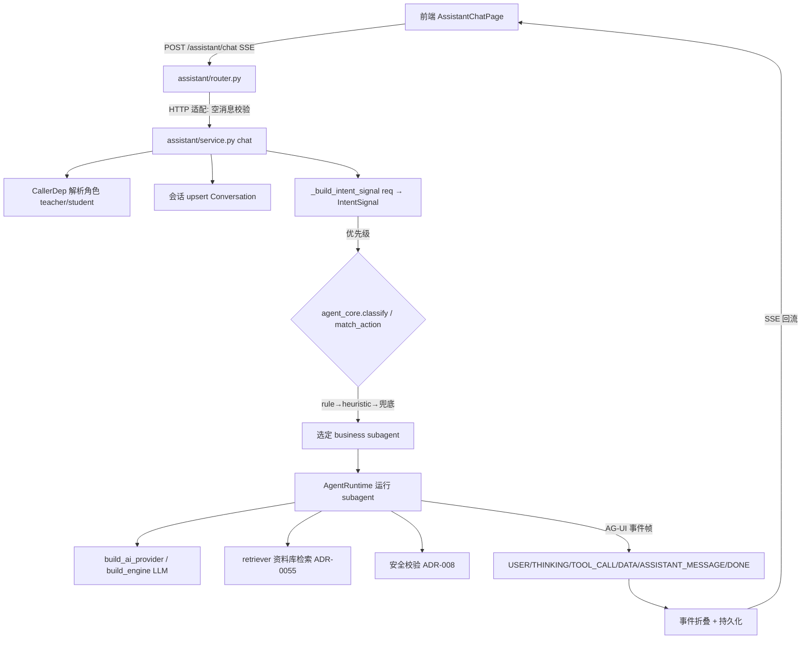
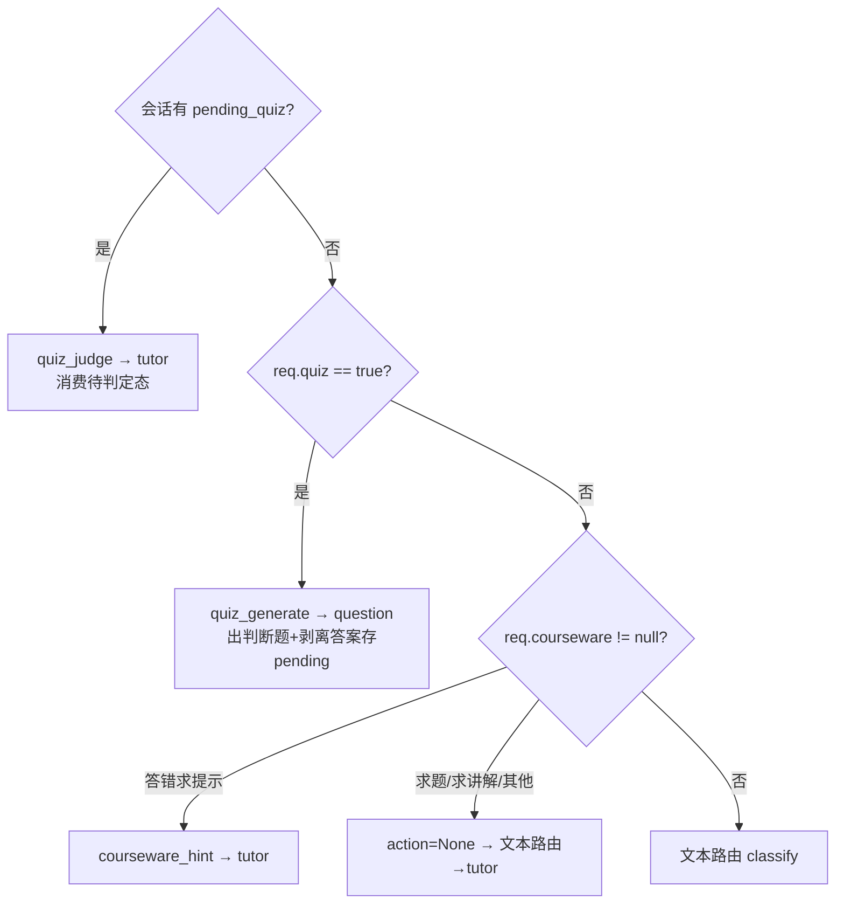
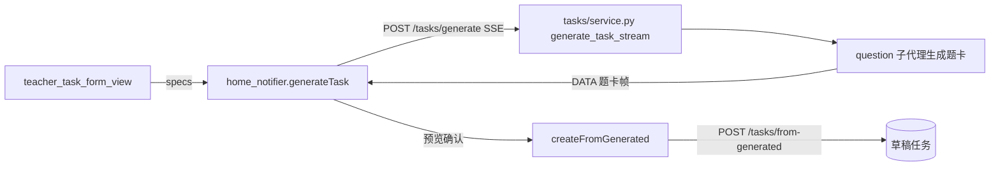
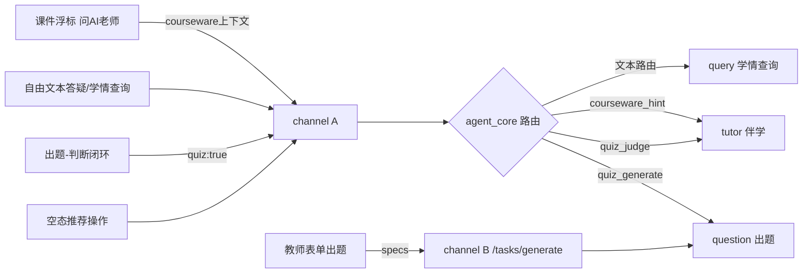

# AI 相关功能架构图（前后端）

> 梳理时间：2026-10-11，分支 `ai-intent-routing`。
> 范围：**当前仍存活**的 AI 能力。已删除的不画进图：服务端「重生成」(`regenerate_one`/`regenerate_all`，ADR-0084)、课件 AI 起草/补充讲解/重新起草(ADR-0085)、课堂练习环节出题/提示 `SectionPractice`(ADR-0086)、课件练习后端半边 `courseware_generate` 信号与 guide 出题分支(ADR-0087)。
> 探查基于代码实态（grep 全仓确认引用点），非函数名猜测。

---

## 1. 总览（Overview）

本项目的 AI 不是分散的多个端点，而是收敛到**一个统一悬浮助手端点** + **一个专属结构化出题端点**两条通道：

- **通道 A · 悬浮助手聊天** `POST /api/v1/assistant/chat`（SSE，AG-UI 事件流）：承载自由文本答疑、课件「问 AI 老师」浮标、出题-判断-引导闭环、空态推荐操作。后端用 `agent_core` 做意图路由，分到 4 个 SubAgent（guide / query / question / tutor）。
- **通道 B · 结构化出题** `POST /tasks/generate`（SSE）→ `POST /tasks/from-generated`（落库）：教师表单式出题，两步法。底层与 question 子代理同源。

前端从不直接发「动作键」字符串——它只发自由文本（后端按触发词路由）或携带 `quiz:true` / `courseware` 上下文。动作键（`task_generate` 等）是**后端内部契约**（manifest `actions` 声明 → 信号归一化 → 等值匹配路由）。

---

## 2. 后端管线（Backend）

### 2.1 统一助手端点流



### 2.2 意图信号归一化（决定走哪个动作键）

`assistant/service.py:_build_intent_signal` 的**动作信号优先级**（写意图先于文本路由）：



`agent_core/router.py` 的两级路由：`classify(text)` = 规则匹配（按 `priority` 降序扫 `triggers`）→ 启发式（`hints`）→ 兜底（`priority` 最低者，即 tutor）。`match_action(action)` 对 manifest `actions` 做**等值**匹配，命中即路由、不参与优先级竞争。

### 2.3 四个 SubAgent（manifest 契约）

| business | priority | roles | actions（声明） | 职责 |
|---|---|---|---|---|
| `guide` | 20 | teacher | （无） | 写意图：创建/派发任务 → 导航到页面（纯由文本 triggers 命中，经 `TARGET_*` → `ShellDestination`） |
| `query` | 12 | teacher+student | （无） | 只读学情查询：任务/错题/待复习/掌握度 |
| `question` | 0 | teacher+student | `task_generate`, `quiz_generate` | 出题助手：按规格出题、判断题闭环出题段 |
| `tutor` | -10 | teacher+student | `courseware_hint`, `quiz_judge` | 伴学答疑：适龄讲解、答错提示、判定讲解 |

### 2.4 专属结构化出题端点



> 注：`task_generate` 动作键虽声明在 question 清单，但前端出题实际走**专属 `/tasks/generate` 端点**（见通道 B），而非经助手聊天的 `action=task_generate`。后者目前是潜伏/次要路径。

---

## 3. 前端（Frontend）

### 3.1 两条 AI 通道

```mermaid
flowchart TD
    subgraph A[通道A · 助手聊天 /assistant/chat]
        FAB[课件讲页 DraggableAssistantFab] --> ACP[AssistantChatPage coursewareContext]
        KP[知识点页/首页] --> ACP2[AssistantChatPage]
        SA[空态推荐操作 SuggestedAction] --> ACP2
        QL[出题-判断闭环 quiz:true] --> ACP2
        ACP --> IN[assistant_input_bar]
        ACP2 --> IN
        IN --> NOT[assistant_notifier.send]
        NOT --> REP[assistant_repository]
        REP --> CLI[assistant_api_client.streamChat]
    end
    subgraph B[通道B · 结构化出题 /tasks/generate]
        TF[teacher_task_form_view] --> HN[home_notifier.generateTask]
        HN --> TREP[tasks_repository]
        TREP --> TCLI[assistant_api_client.streamGenerate 扩展]
        TCLI -->|落库| FG[/tasks/from-generated]
    end
    CLI --> NET[NetworkService.streamPost SSE]
    TCLI --> NET
    NET -->|AG-UI 帧| FOLD[AiTextFold 折叠]
    FOLD --> MSG[AssistantMessage 气泡: text/cards/sources]
    MSG --> LIST[assistant_message_list 渲染]
    LIST -->|卡片 actions.target| SD[ShellDestination.fromTarget]
    SD -->|TARGET_*| NAV[壳导航到目标页]
```

### 3.2 关键前端组件

- **入口**：`courseware_present_page.dart` 用 `DraggableAssistantFab` 包住打开 `AssistantChatPage(coursewareContext: AssistantCoursewareContext(...))`（:294-303）；首页/知识点页直接开 `AssistantChatPage`；教师出题走 `teacher_task_form_view` + `home_notifier`。
- **状态**：`assistant_notifier.dart`（`StateNotifier<AssistantState>`）——持有会话 `session_id`（首轮 DONE 帧回写、归属失败自愈换新）、历史尾截 20 条喂 prompt、调 `AiTextFold` 把事件流折叠成气泡。
- **客户端**：`assistant_api_client.dart` 同时有 `streamChat`(`/assistant/chat`) 与扩展 `streamGenerate`(`/tasks/generate`)，共用同一套 SSE 分帧解析（ADR-0034 两接口事件协议一致）。
- **结果渲染**：`assistant_message_list` + 卡片渲染器画题卡/任务卡/学情卡；卡片里的 `actions=[{label,target}]` 经 `ShellDestination.fromTarget`（`shell_navigation.dart:27`）switch 后端 `guide/agent.py` 的 `TARGET_*` → 壳导航；**未知 target 必须返回 null、什么都不做**。

---

## 4. 能力映射（前端入口 → 后端子代理）



---

## 5. Gotchas（易错点）

1. **`courseware_generate` 已彻底移除（ADR-0087）**：ADR-0086 删了课堂练习前端 UI 与 `section.practice`，但后端 `_build_intent_signal` 仍发射该键、guide 仍调 LLM 出大屏题，形成不完整的删除。ADR-0087 补完后端半边：guide 现**无任何动作键**，课件上下文只「答错求提示」→ `courseware_hint`，其余（含求题/求讲解）交回文本路由到 tutor。别以为浮标还能「引导到大屏出题」——FAB 是纯「问 AI 老师」（tutor/query）。
2. **两条出题路径并存**：前端教师表单走专属 `/tasks/generate`；助手聊天里的 `task_generate` 动作键目前是潜伏路径。两者底层都归 question 子代理。
3. **`req.courseware` 不自动定向子代理**：它只提供上下文；仅「答错求提示」→ `courseware_hint`，其余（如求讲解）照常文本路由到 tutor。带 `quiz` 的请求必须排在课件方向之前，否则会被课件标记劫持而跑不到出题。
4. **动作键是后端内部契约**：前端从不发 `action` 字符串（全仓 grep 无 `task_generate` 等引用）。前端只发文本 / `quiz:true` / `courseware` 上下文，路由全在后端。
5. **出题-判断闭环（保留）**：`req.quiz=true` → `quiz_generate` 出判断题并**剥离答案**存入 `pending_quiz`；用户下一条消息若会话有 `pending_quiz` → `quiz_judge`（tutor 由 LLM 判定+讲解，服务端不做对错比较）。本次（2026-10-11）复核确认该闭环仍**完整存活**（后端 `pending_quiz`/两个处理函数 + 前端「出一道判断题」按钮 `quiz:true` 均在且可用），未随 ADR-0086 删除，故保留。
6. **角色从 JWT 解析**：guide 仅教师；query/question/tutor 双端。前端 `courseware` 字段在 ADR-0086 后已精简（移除 `sectionId`/`extra`），仅留知识点/学科/年级/学期。
7. **卡片 target 受控枚举**：后端 `guide/agent.py` 的 `TARGET_*` 是线协议；前端 `ShellDestination.fromTarget` 认不出即 no-op，新增 target 须前后端同改。

---

## 6. 文件地图（Where Things Live）

**后端**
- `app/features/assistant/router.py` — 统一端点 + 会话读/删
- `app/features/assistant/schemas.py` — `AssistantChatReq` / `CoursewareContext` / `SuggestedAction`
- `app/features/assistant/service.py` — `chat` 编排 + `_build_intent_signal` + quiz 闭环 + `build_suggested_actions`
- `agent_core/router.py` — `classify` / `match_action` / `IntentSignal`（业务无关路由）
- `app/ai/subagents/{guide,query,question,tutor}/manifest.py` — 各子代理词表/优先级/动作键
- `app/features/tasks/router.py` + `service.py` — `/tasks/generate` + `/tasks/from-generated`
- `app/features/ai/router.py` / `app/features/tutor/router.py` — 历史/备用路由（注意区分）

**前端**
- `features/assistant/presentation/{screens,wigits,provider}` — `AssistantChatPage` / `assistant_notifier` / `assistant_message_list` / `assistant_input_bar` / `assistant_suggested_actions`
- `features/assistant/data/assistant_api_client.dart` — `streamChat` + `streamGenerate`
- `features/assistant/domain/` — `assistant_requests` / `assistant_event` / `assistant_card` / `ai_text_fold` / `conversation`
- `features/courseware/.../courseware_present_page.dart` — 浮标入口
- `features/home/.../home_notifier.dart` + `teacher_task_form_view.dart` — 结构化出题入口
- `shared/presentation/shell_navigation.dart` — `ShellDestination.fromTarget`
- `shared/domain/models/assistant_courseware_context.dart` — 课件上下文模型
