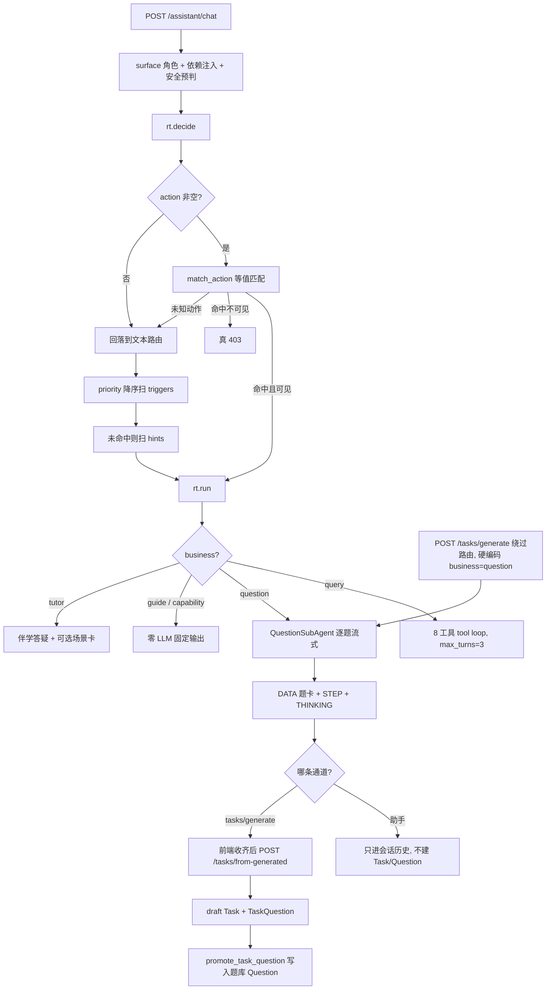

# AI 能力现状盘点

> 盘点对象：`backend/agent_core` 内核 + `backend/app/ai/subagents/*` 业务插件 + 三条旁路。
> 所有行号基于当前工作树，已逐条读源码核验；标注「未验证」的条目来自静态推断，没有跑测试。
> 日期：2026-10-14

## 这套东西是什么

内核在 `backend/agent_core/`（顶层包，不叫 `app.agent_core`），只做三件事：扫 manifest 发现插件、按 priority 做意图路由、驱动 tool loop。它不认识「学科」「年级」「知识点」这些概念，教育语义全部通过 `SubAgentContext.extra` 这个字典透传。业务侧挂了五个 SubAgent：`guide`、`capability`、`query`、`question`、`tutor`。

整个系统只有一个 AI 生成入口 `POST /api/v1/assistant/chat`，另有三条不进聊天会话的旁路：结构化出题端点 `/tasks/generate`、批改 `Grader`、资料知识点抽取。前端只有一个 AI 入口，`assistantNotifierProvider` + `AssistantMessageList`，后端只有这一个 SSE 端点。

这套结构回答了三个具体问题：不同意图怎么确定性地落到不同处理器（答案是 priority 加触发词，不用 LLM 做意图分类）；模型怎么查业务数据（答案是八个只读工具经 feature service 取数，工具层不许碰 repository）；同一份流式结果怎么同时给「人看」和「模型读」（`TOOL_RESULT` 存原始载荷进模型上下文，`DATA` 帧存投影卡片给人看）。

## 先要认识的几个概念

**SubAgent** 是一个带 `manifest.py` 的文件夹，实现 `run(message, ctx)`。manifest 声明 business、roles、triggers、hints、priority、actions、skills。运行时由 `discover_subagent_manifests`（`agent_core/registry.py:100`）扫目录加载，不需要注册表手工登记。

**business** 是 manifest 里的业务键，也是路由的唯一输出值。

**priority** 决定文本路由的扫描顺序。`_rule_match` 按 priority 降序扫各业务的 `triggers`，子串命中即返回，不做打分。

**action 直配** 在 priority 竞争之上。`IntentSignal.action` 与各 manifest 的 `actions` 列表做等值匹配，命中立即路由。当前只有 `question` 声明了一个动作键 `task_generate`。

**surface** 是 `_surface_of`（`assistant/service.py:146`）把账户角色折算成的调用面：只有 `Role.STUDENT` 走 `student`，教师和 admin 都走 `teacher`。角色从 JWT 解出，客户端传不了。

**`DATA` 帧的 `data.type`** 是卡片判别键，前端据此分派渲染器；`data.result` 是该种类的结构化载荷，服务端不拼展示串。

## 能力清单

| 能力 | business | 怎么触发 | 用 LLM 吗 | 产出 | 落库 |
| --- | --- | --- | --- | --- | --- |
| 出题 | `question` | 文本路由落到 `question`（priority 0）；或教师填表走 `POST /tasks/generate`；或 `action=task_generate`（只有测试在用） | 每题一次约束解码 | `STEP` 进度 + `THINKING` 推理 + `DATA` 题卡 | 助手侧只进会话历史；任务侧不落库，等第二步 `/tasks/from-generated` |
| 学情查询 | `query` | 文本路由（priority 12） | 选型用 LLM，数据由八个只读工具查出 | `TOOL_CALL` / `TOOL_RESULT` / `DATA` 卡片 / 收尾正文 | 事件消息进 `Message`，查到的数据不落库 |
| 任务引导 | `guide` | 教师说「创建任务 / 布置作业」等高精度短语（priority 20） | 不用 | 一张 `DATA` 引导卡，带受控跳转 target | 会话历史 |
| 能力自述 | `capability` | 「你能做什么 / 你是谁」（priority 16） | 不用，服务端固定常量 | 一段 `ASSISTANT_MESSAGE` | 会话历史 |
| 伴学答疑 | `tutor` | 兜底（priority -10），或命中「为什么 / 讲解 / 不会」 | 讲解流式用，另可选一次微调用判定要不要出图 | 文本流 + `DATA(rag_sources)` + 可选 `DATA(interactive_scene)` | 会话历史，学生端额外写 `TutorLog` |
| 批改 | 无 manifest，`app/domain/grader.py:44` | `POST /tasks/{id}/answer`（练习）、复习作答 | 只有 `open` 题用 LLM，其余走确定性比对 | `correct` / `score` / `explanation` | 作答记录 → 错题 → 复习计划 |
| 资料知识点抽取 | 无 manifest，旁路 | 资料上传自动跑，或手动重提取 | 一次 `MaterialMeta` 约束解码 | 学科 / 年级 / 学期 + 知识点名 | 写 material 列并对齐知识点目录 |

复习调度（`review_scheduler.py:13` 的 `REVIEW_INTERVALS_DAYS = (1,2,4,7,15)`）和掌握度 `build_mastery` 是纯算法，读时计算，不含模型调用，不在这张表里。

## 主流程

端点 `assistant_chat`（`app/features/assistant/router.py:43`）只做空消息校验和包 `StreamingResponse`。编排全在 `assistant_service.chat`（`service.py:323`）。因为 `chat` 是普通 async 函数返回迭代器，端点先 `await` 它，所以 `chat` 里抛的异常会在建流之前变成真 HTTP 403，而不是被塞进 SSE 帧。

执行顺序：

1. 解身份。学生取自身 id 作 student_id；教师和 admin 取自身作 teacher_id。
2. 探测 subject。课件元数据优先，否则 `detect_subject(message)`。
3. 构造依赖。`resolve_engine`（`app/ai/engine.py:109`）读 `ModelConfig` 表，key 经 Fernet 加密，没有内置模型目录也没有离线 mock；`build_retriever` 按 teacher_id 启用教师私有资料库；安全闸门只有学生面挂 `StudentSafety`，教师面是 `None`。
4. 安全预判，得出 `input_flags` 供本轮每一步共用。
5. 会话定位。`session_id` 存在且归属匹配才续接，否则当不存在处理。
6. 预路由 `rt.decide`。顺序是：输入安全闸门 → action 等值直配 → 文本路由。文本路由本身三级：priority 降序扫 `triggers` 子串 → 扫 `hints` 子串 → 落到 priority 最低者即 `tutor`。
7. action 命中但角色不可见时，`decide` 返回 `extra={"reason":"action_not_visible"}`，service 抛 `ErrCode.FORBIDDEN`。这里刻意不做「换一个可见业务」的静默兜底，那会把越权变成答非所问。
8. 会话 upsert 与历史装载。超 4000 token 走 compaction，用本次 provider 把最旧轮次压成一句摘要注入，压缩失败就纯丢弃。
9. `resolve_kp_focus` 做知识点聚焦，归属校验不过就返回 None，不注入。
10. 构造 `ctx`，业务字段全进 `extra`。
11. `rt.run` 产出事件流：固定发 `RUN_STARTED` / `USER_MESSAGE` / 两条 `THINKING(routing)`，然后 `run_with_tools`，最后 `DONE`。
12. 边流边落库，`SUGGESTED_ACTIONS` 在流末尾单独下发且不落库。

### 五个 manifest 的真实参数

| business | priority | roles | actions | LLM |
| --- | --- | --- | --- | --- |
| guide | 20 | teacher | 无 | 无 |
| capability | 16 | teacher, student | 无 | 无 |
| query | 12 | teacher, student | 未声明 | 选型用 |
| question | 0 | teacher, student | `task_generate` | 用 |
| tutor | -10 | teacher, student | 无 | 用 |

`guide` 限教师的原因是学生端没有发布任务入口，学生说「帮我创建任务」落到 query 会得到只读答复。`capability` 排 16 是为了压住 query 里的泛词「查 / 有哪些」，否则「你能查什么」会被 query 的 `requires_tool_data` 判成未查先答而硬失败。

## 出题的两条通道



**通道 A，助手内自由文本出题。** 路由落到 `question` 后，`QuestionSubAgent.run`（`agent.py:345`）先看 `ctx.extra["specs"]`，没有就走 `parse_specs_from_text`：正则识别学科别名、年级（阿拉伯和中文数字两种写法）、数量（上限 5）、题型、多选标记、判断题标记、知识点。解析不到就追问「请告诉我科目、年级和题型」。

`expand_specs`（`agent.py:67`）按 `count` 展开成「每题一条」，顺序即 q_index。然后发一个伪工具帧 `generate_question`，它只是一条 `TOOL_CALL` 记录，用来让前端显示「出题」标签，没有 handler 也不进 tool loop。

逐题串行处理，每题四步：`build_question_context` 做 RAG 检索加学科 Persona 加 `source_refs` 快照；`figure_catalog_for_question` 注入可用图形清单，只给 key 和中文名，顶点不进 prompt，任何异常都返回 None 不阻断；`build_question_prompts` 拼 prompt；`stream_question` 以 `provider.stream(schema=QuestionSchema)` 做约束解码，末帧 `StructuredDone` 后经 `assemble_question`（`parsers.py:117`）过安全闸门。题面是硬闸门，`stem` + `answer` + `explanation` 拼起来过不了 `check_output` 就整题作废；reasoning 是软闸门，推理不安全只丢推理，题卡照发。失败记进 `failures`，收尾如实报「应出 N 题，实出 M 题」。

**通道 B，教师结构化出题。** `POST /api/v1/tasks/generate` → `generate_task_stream`（`tasks/service.py:1062`）。这里绕过路由，直接 `rt.run(business="question")`，`safety=None`，不落 Conversation/Message，也不发 SUGGESTED_ACTIONS。specs 经 `TaskSpec.model_dump()` 进 `ctx.extra["specs"]`，由 Pydantic 校验学科白名单、题型白名单、`multi=true` 仅 choice。

落库是分开的第二步：`POST /tasks/from-generated` → `create_from_generated`（`tasks/service.py:552`）。它不重新调模型，只处理前端回传的同一批题卡：归属校验 → `_valid_choice_options`（选择题必须 ≥2 个非空文字选项，否则 422 `TASK_20018`）→ `_stamp_option_figures`（figure_key 换内联几何，全有或全无）→ scene_spec 归一化 → `TaskQuestion` → `batch_generate_task`（状态 draft）。教师确认后再「加入题库」，由 `promote_task_question`（`tasks/repository.py:184`）写 `Question` 行，这是全工程唯一构造 `Question` 的地方。

## 查询的 tool loop

`QuerySubAgent`（`query/agent.py:50`）是唯一持有真实工具的 SubAgent。`QUERY_TOOLS`（`tools/registry.py:19`）的顺序就是下发给模型的顺序，`list_students` 排第一，对应「不确定查谁就先列学生」的 SOP。

八个工具全部只读，全部经 feature service 取数：`list_students`、`list_teacher_tasks`、`list_today_tasks`、`list_wrong_questions`、`list_due_reviews`、`list_bank_questions`、`get_progress`、`get_mastery`。

tool loop 在 `agent_core/subagent.py:213`。`tools` 为空时直接转发 `agent.run`（question、tutor、guide、capability 都走这条）；非空时把 `registry.schemas()` 随请求发出去，收到原生 `ToolCall` 就 `yield tool_call` → 执行 handler → `yield tool_result` → 回灌 → 再请求，直到模型不再要工具，`max_turns=3`。

三类硬失败要分清：`TOOL_UNSUPPORTED` 是模型没给原生 ToolCall 却把调用写进了思维链或正文；`PROVIDER_ERROR` 是厂商 401 或限流，它刻意和 TOOL_UNSUPPORTED 分开，把 401 说成「不支持工具调用」会让用户去换模型而真问题是密钥；`TOOL_TURN_LIMIT` 是超了三轮。`requires_tool_data=True` 又加了一类「未查先答」，整轮零工具调用却给了正文就直接拦截。`REASONING` 通道只进思考缓冲，既不进答案也不进回灌历史。

工具层的安全口径集中在 `_shared.py`：学生恒查自己，`resolve_students` 直接忽略传入的 student_id；教师指定了不在名下的目标会抛 `ToolArgumentError` 而不是返回空，这是为了不让模型把「你没这个学生」误读成「这个学生没数据」；`project_for_role` 在学生端递归剥掉 `ANSWER_FIELDS = {answer, explanation}`；`optional_str` 和 `UNSET_TOKENS`（11 个，含字符串形式的 "null"）处理 strict 模式下模型补位的空串和 0。

没有分页。八个工具只有 `limit`，没有 cursor，`app/core/pagination.py` 那套 keyset 是给 REST 端点用的，`questions/repository.py:48` 的注释写明了这个分工。`graduated_at IS NULL`（过滤已毕业错题）在 repository 层强制，工具层完全看不到。

AST 守卫 `tests/ai/test_layering_invariants.py:171` 禁止 query 工具 import router、repository、fastapi；另一段禁止源码里出现 `x.teacher_id != y` 形式的内联归属比较，归属只许走 `core.guard`。

## 文件地图

```
backend/agent_core/              业务无关内核（顶层包）
  router.py                      IntentSignal / match_action / classify
  runtime.py                     AgentRuntime：decide 预路由 + run 事件编排
  subagent.py                    BaseSubAgent / run_with_tools tool loop
  registry.py                    manifest 发现，拼接 skills/*.md
backend/app/ai/
  engine.py                      resolve_engine：ModelConfig 是唯一模型源
  subagents/<biz>/               manifest.py + agent.py + skills/*.md
    question/                    agent.py 编排，pipeline.py 提示与闸门，parsers.py 契约
    query/                       tools/ 八个只读工具，render.py 卡片投影
    tutor/                       scene_intent.py 三层场景识别
backend/app/features/
  assistant/                     router.py 唯一入口，service.py 全部编排
  tasks/                         service.py:1062 流式生成，:552 落库两步法
  materials/                     service.py:343 资料元数据抽取
backend/app/domain/
  grader.py                      批改
  review_scheduler.py            遗忘曲线状态机（算法）
frontend/lib/features/assistant/
  assistant_card.dart            AssistantCardKind 常量表
  assistant_cards.dart           按 kind 分派渲染器
```

`app/ai/runtime/` 和 `app/ai/subagents/tasks/` 只剩 `__pycache__`，源码已迁走，但 `assistant_event.dart:1` 的注释还指向 `app/ai/runtime/protocol.py`（真身在 `agent_core/protocol.py`）。`TruncateOversizedToolResultHook` 已实现但默认不挂载。

## 需要知道的坑

**多选题在出题链路里被静默丢弃（已核验代码）。** `expand_specs` 构造的 item 只有 subject、grade、knowledge_point、qtype、difficulty、semester、judge 七个键，没有 multi。`agent.py` 全文件没有出现 multi，`pipeline.py:196` 的 `QuestionSpec(multi=multi)` 拿到的一直是默认值 False。链条是：`TaskSpec.multi` 的 Pydantic 校验允许 true → 进 `ctx.extra["specs"]` → `expand_specs` 丢掉 → 题卡 `multi=false` → `create_from_generated` 读题卡的 multi → `TaskQuestion.multi=false`。唯一能写出 `multi=true` 的路径是 `/tasks/from-generated` 里客户端自己回传 `q["multi"]`。因此 `Grader` 的集合比对分支（`grader.py:52`）实际不可达。这条是静态推断，没有跑测试验证运行时行为。

**backend 发 `student_list`，前端只认 `child_list`（已核验）。** `render.py:34` 是 `"list_students": "student_list"`，前端 `assistant_card.dart:180` 只有 `childList = 'child_list'`，全仓没有 `student_list` 字面量。后果不是丢内容，降级分支会渲染出一张标题「学生」的中性提示卡，但给 childList 配的用户图标永远用不上。这是 `child_*` → `student_*` 改名留下的漂移，同一批改动还漏了 SOP：`skills/query_sop.md` 还在教模型用 `child_name` / `list_children`，而 `agent.py:34` 的 system prompt 用的是 `student_name` / `list_students`，两份文本会同时进模型的上下文。

**`task_generate` 是潜伏动作键（已核验）。** 前端 `AssistantChatReq.toJson()` 不含 action 字段，没有任何 Dart 代码发过 action。全仓命中集中在 manifest 声明、注释、ADR 和测试。也就是说生产出题走的是文本路由或 `/tasks/generate`，这条优先级更高的通道目前只有测试在用。

**ADR-0090 删掉了三个旧动作键（已核验）。** `quiz_generate` / `quiz_judge` / `courseware_hint` 现在只出现在注释、ADR 文档和回归测试里，源码中没有任何注册或判定分支。`Conversation.pending_quiz` 列在 `app/core/db.py:480` 启动期 DROP。判断题闭环现在靠「题卡含答案原样落历史 → tutor 从历史读答案判定」，输入是 `_question_card_text`（`assistant/repository.py:59`）拼成的文本，不是结构化状态机。契约测试 `test_intent_routing_contract.py:47` 硬钉 `m.actions == ["task_generate"]`。

**没有「教师手动录题」这条路（已核验）。** `QUESTION_ORIGIN_TEACHER`（`db/models/question.py:13`）定义了但全仓无人写入，`Question.origin` 恒为默认值 `ai`。`tasks/repository.py:184` 是唯一的 `Question(...)` 构造点。所以 prompt 里防「教师从教辅照抄」的红线目前防的是一个不存在的入口。

**ADR-0081 §2.8 没有落地。** 它要求「服务端全量下发、客户端控显」，但 `project_for_role` 仍在服务端剥答案。另外 ADR-0082 提到的 `Question.owner_id` 在当前模型里不存在（只有 `teacher_id`），学生出题沉淀为 Question 行这件事也没实现。

**以下四条保持为静态推断，未逐行复核：** `list_teacher_tasks` 在学生端语义切成今日任务；`list_today_tasks` 的「今天」按 `created_at` 当天算而不是到期日；admin 走 teacher 面但名下无学生导致 query 结果恒空；`registry.py:1` 的 docstring 写「7 个只读工具」而实际是 8 个。
